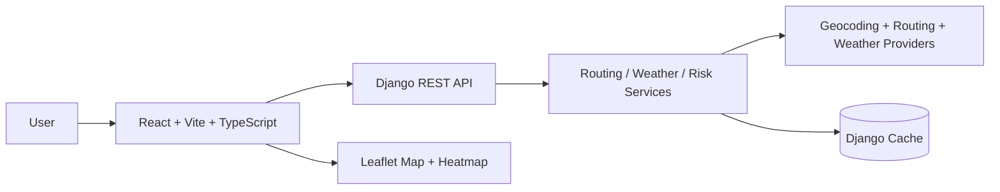

# Weather-Aware Truck Routing

## Overview
Weather-Aware Truck Routing helps a driver compare multiple route options while accounting for weather risk, load weight, and travel time. The application generates three route alternatives, samples weather at route checkpoints, scores each route against the specified load and weather thresholds, and recommends the safest route that still balances travel time.

This project uses:
- React + Vite + TypeScript for the frontend
- Django + Django REST Framework for the backend
- Open-Meteo for weather forecasts
- Geocoding and routing providers behind a provider abstraction layer
- Leaflet + react-leaflet for map rendering

## Architecture


## Project structure
```text
.
├── .env.example
├── README.md
├── render.yaml
├── backend/
│   ├── config/
│   ├── routing/
│   ├── services/
│   ├── tests/
│   ├── requirements.txt
│   ├── manage.py
│   └── Procfile
├── frontend/
│   ├── src/
│   ├── package.json
│   ├── vite.config.ts
│   └── vercel.json
└── .gitignore
```

## Assumptions
- OpenStreetMap/Nominatim is used for geocoding and OpenRouteService/Mapbox-style route providers are abstracted behind the provider layer.
- Weather forecast sampling uses Open-Meteo hourly forecasts and nearest-hour or interpolated values by ETA.
- The app uses UTC internally and converts to local time only in the UI presentation layer.
- If a provider is unavailable or a request fails validation, the service returns a clear validation/error response instead of silently failing.
- The project assumes a free-tier third-party provider configuration and uses caching to reduce repeated requests.
- A live production deployment is configured with environment variables and not with hard-coded secrets.

## Setup and run instructions
### 1) Install Python dependencies
```bash
cd backend
python -m venv .venv
# Windows
.\.venv\Scripts\Activate.ps1
# macOS/Linux
source .venv/bin/activate
pip install -r requirements.txt
```

### 2) Install frontend dependencies
```bash
cd frontend
npm install
```

### 3) Configure environment variables
Copy the example file and update values:
```bash
cp .env.example .env
```
Then update values such as:
- `SECRET_KEY`
- `ALLOWED_HOSTS`
- `CORS_ALLOWED_ORIGINS`
- `FRONTEND_URL`
- `VITE_API_BASE_URL`
- optional provider keys such as `ORS_API_KEY` and `MAPBOX_API_KEY`

### 4) Run the backend
```bash
cd backend
python manage.py migrate
python manage.py runserver 0.0.0.0:8000
```

### 5) Run the frontend
```bash
cd frontend
npm run dev
```

### 6) Run tests
```bash
cd backend
python -m pytest -q
```

## Environment variables
The app reads configuration from `.env` via `python-dotenv` and `VITE_API_BASE_URL` for the frontend.

Example values:
```env
DEBUG=True
SECRET_KEY=replace-me-with-a-secure-secret
ALLOWED_HOSTS=localhost,127.0.0.1
CORS_ALLOWED_ORIGINS=http://localhost:5173
FRONTEND_URL=http://localhost:5173
VITE_API_BASE_URL=http://localhost:8000
GEOCODING_PROVIDER=nominatim
ROUTING_PROVIDER=ors
WEATHER_PROVIDER=open-meteo
```

## API endpoints
### GET /api/geocode?q=...
Geocodes a free-form location string and returns a list of candidates with latitude and longitude.

### POST /api/analyze
Request body:
```json
{
  "origin": "New York, NY",
  "destination": "Chicago, IL",
  "departure_time": "2026-10-21T12:00:00Z",
  "load_lb": 28000,
  "interval_miles": 25
}
```

Response includes route geometries, checkpoints, ETAs, weather values, risk classifications, per-route metrics, and the recommended route id.

### POST /api/heatmap
Returns corridor heatmap samples and hourly risk metadata. The slider logic is rendered on the frontend client-side for 0–48 hour forecast browsing.

## Risk rules
The service applies the following lower-bound-inclusive thresholds.

### Wind speed (mph)
| Level | Threshold |
|---|---|
| Low | <25 |
| Moderate | 25–34 |
| High | 35–44 |
| Severe | 45–54 |
| No Travel | >=55 |

### Rain (in/hr)
| Level | Threshold |
|---|---|
| Low | <0.10 |
| Moderate | 0.10–0.25 |
| High | 0.25–0.50 |
| Severe | 0.50–1.00 |
| No Travel | >1.00 |

### Snow (in/hr)
| Level | Threshold |
|---|---|
| Low | <0.5 |
| Moderate | 0.5–1.0 |
| High | 1.0–2.0 |
| Severe | 2.0–3.0 |
| No Travel | >3.0 |

### Load rule escalations
- Wind >= 55 mph => No Travel for any load
- Wind 45–54 mph and load > 30,000 lb => No Travel
- Wind 35–44 mph and load > 40,000 lb => Severe

## Recommendation logic
Routes are ranked lexicographically by:
1. Fewest No Travel miles
2. Fewest Severe miles
3. Fewest High miles
4. Lowest average risk
5. Shortest travel time

This ranking prefers safer operation first while still balancing travel time when risk is equivalent.

## Limitations and caveats
- Provider usage depends on external API availability and rate limits.
- Weather values are forecast-based and may differ from live local conditions.
- Route geometry and ETA estimates are approximate and designed to support planning rather than real-time dispatch.
- Map and heatmap rendering are tuned for clarity and performance under typical route lengths rather than extremely large datasets.

## Production deployment
### Backend on Render
1. Push the repository to GitHub.
2. Sign in to Render and create a new Web Service.
3. Connect the repository.
4. Set the root directory to `backend` or use the root service with `render.yaml`.
5. Use the included `render.yaml` as a deployment blueprint.
6. Set the following environment variables:
   - `DEBUG=False`
   - `SECRET_KEY=<secure value>`
   - `ALLOWED_HOSTS=your-render-domain`
   - `CORS_ALLOWED_ORIGINS=https://your-frontend-domain.vercel.app`
   - `FRONTEND_URL=https://your-frontend-domain.vercel.app`
7. Deploy. Render will run the backend with gunicorn.

### Frontend on Vercel
1. Push the repository to GitHub.
2. Import the project in Vercel.
3. Set the project root to `frontend`.
4. Add environment variable:
   - `VITE_API_BASE_URL=https://your-render-backend-url`
5. Deploy. The included `vercel.json` ensures client-side routing falls back to `index.html`.

### Netlify alternative
- Build command: `npm run build`
- Publish directory: `frontend/dist`
- Environment variable: `VITE_API_BASE_URL=https://your-render-backend-url`

## Loom walkthrough outline
1. Start with a 20-second overview: truck route comparison, weather risk, and recommended path.
2. Show the input form and explain origin, destination, departure time, load weight, and checkpoint interval.
3. Show the three route overlays on the map and highlight the recommended route.
4. Click a checkpoint and explain ETA + weather conditions + risk classification reasoning.
5. Walk through the route summary cards and explain the ranking logic: No Travel miles, Severe miles, High miles, average risk, travel time.
6. Demo the 0–48 hour heatmap slider and describe how the forecast is sampled along the corridor.
7. Close with the deployed architecture and note that the app is designed for weather-aware routing decisions rather than live dispatching.

## Notes for reviewer
- The backend includes service-layer testing for risk thresholds, recommendation ordering, and checkpoint generation.
- The frontend compiles to a production build and includes the route dashboard, checkpoint details, and heatmap slider.
- Production config uses environment-based secrets and CORS configuration rather than hard-coded credentials.
