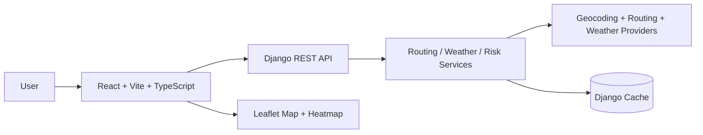

# Weather-Aware Truck Routing

## Overview
Weather-Aware Truck Routing helps a driver compare multiple route options while accounting for weather risk, load weight, and travel time. The application generates three route alternatives, samples weather at route checkpoints, scores each route against the specified load and weather thresholds, and recommends the safest route that still balances travel time.

This project uses:
- React + Vite + TypeScript for the frontend
- Django + Django REST Framework for the backend
- Open-Meteo for weather forecasts
- Geocoding and routing providers behind a provider abstraction layer
- Leaflet + react-leaflet for map rendering

## Live application
- Frontend: https://weather-aware-truck-routing-seven.vercel.app/
- Backend API: https://weather-aware-truck-routing-api-3sba.onrender.com/

The frontend's production build must have `VITE_API_BASE_URL` set to the backend base URL above (without `/api`). The backend uses the public OSRM driving router by default, so a routing API key is not required. OpenRouteService remains available as an optional provider when an `ORS_API_KEY` is configured.

**Deployment verification:** The Render backend is configured to use the public OSRM driving router by default, so route analysis does not depend on an OpenRouteService API key. The deployed API was verified with a Chicago-to-Denver request departing at `02:30 UTC`: it returned three scored routes, weather and risk at each checkpoint, route metrics, and a recommendation. The same request's heatmap returned 49 hourly snapshots (hour 0 through hour 48) across 293 corridor points. Provider errors are surfaced; unscored or fallback routes must not be presented as analyzed results.

## Architecture


## Project structure
```text
.
├── .env.example
├── README.md
├── render.yaml
├── backend/
│   ├── config/
│   ├── routing/
│   ├── services/
│   ├── tests/
│   ├── requirements.txt
│   ├── manage.py
│   └── Procfile
├── frontend/
│   ├── src/
│   ├── package.json
│   ├── vite.config.ts
│   └── vercel.json
└── .gitignore
```

## Assumptions
- OpenStreetMap/Nominatim is used for geocoding. OSRM is the default driving router; OpenRouteService is an optional keyed alternative.
- Route ETAs are interpolated proportionally by distance because the route provider response supplies total duration rather than per-step arrival times.
- Checkpoint spacing and risk-mile totals use the routing provider's route distance. Geometry-derived distances are scaled proportionally when the route polyline's calculated length differs slightly from the provider's road distance.
- Weather forecast sampling uses Open-Meteo hourly forecasts and selects the nearest forecast hour to each ETA (not interpolation).
- The app uses UTC internally and converts to local time only in the UI presentation layer.
- Average risk is the distance-weighted mean of final checkpoint risk levels: sum each segment's numeric risk level multiplied by its segment miles, divided by total segment miles (Low=0 through No Travel=4). Miles by risk level are distance totals from the checkpoint segments.
- Heatmap data includes hourly snapshots for hour 0 through hour 48 inclusive (49 snapshots spanning 48 elapsed hours), sampled at a capped set of center and approximately 12-mile corridor points.
- If a provider is unavailable or a request fails validation, the service returns a clear validation/error response instead of silently failing.
- The project assumes a free-tier third-party provider configuration and uses caching to reduce repeated requests.
- A live production deployment is configured with environment variables and not with hard-coded secrets.

## Setup and run instructions
### 1) Install Python dependencies
```bash
cd backend
python -m venv .venv
# Windows
.\.venv\Scripts\Activate.ps1
# macOS/Linux
source .venv/bin/activate
pip install -r requirements.txt
```

### 2) Install frontend dependencies
```bash
cd frontend
npm ci
```

### 3) Configure environment variables
From the repository root, copy the backend example file and update values:
```bash
Copy-Item .env.example .env
# macOS/Linux: cp .env.example .env
```
For local frontend development, copy the frontend example:
```powershell
Copy-Item frontend\.env.example frontend\.env.local
# macOS/Linux: cp frontend/.env.example frontend/.env.local
```
Set a private `SECRET_KEY`. The default OSRM router needs no API key. To use OpenRouteService instead, set `ROUTING_PROVIDER=ors` and provide a valid `ORS_API_KEY`.

### 4) Run the backend
```bash
cd backend
python manage.py migrate
python manage.py runserver 0.0.0.0:8000
```

### 5) Run the frontend
```bash
cd frontend
npm run dev
```

### 6) Run tests
```bash
cd backend
python -m pytest -q
```

### 7) Validate the frontend
```bash
cd frontend
npm run lint
npm run format
npm run build
```

## Environment variables
The backend reads the root `.env` via `python-dotenv`. Vite reads `frontend/.env.local` (or the Vercel project environment) for `VITE_API_BASE_URL`. Backend settings default `DEBUG` to `False` and reject startup without a `SECRET_KEY` when debug is disabled.

| Variable | Location | Required | Purpose |
|---|---|---:|---|
| `DEBUG` | Backend | No (defaults to `False`) | Set `True` only for local development. |
| `SECRET_KEY` | Backend | Yes when `DEBUG=False` | Private Django signing key; use a unique secret on the host. |
| `ALLOWED_HOSTS` | Backend | No | Comma-separated Django hostnames; defaults to localhost. |
| `CORS_ALLOWED_ORIGINS` | Backend | No | Comma-separated browser origins allowed to call the API. |
| `FRONTEND_URL` | Backend | No | Fallback frontend origin used for CSRF trusted origins. |
| `GEOCODING_PROVIDER` | Backend | No | Provider selector; supported value is `nominatim`. |
| `ROUTING_PROVIDER` | Backend | No | Provider selector; supported values are `osrm` (default) and `ors`. |
| `WEATHER_PROVIDER` | Backend | No | Provider selector; supported value is `open-meteo`. |
| `ORS_API_KEY` | Backend | Only with `ROUTING_PROVIDER=ors` | Secret key for OpenRouteService road routing. |
| `PORT` | Backend host | Host supplied | Listening port; Render supplies it automatically. |
| `VITE_API_BASE_URL` | Frontend | Yes for deployment | Backend base URL, without a trailing `/api`. |

Nominatim, OSRM, and Open-Meteo do not require API keys. `VITE_API_BASE_URL` belongs in `frontend/.env.local` locally and in Vercel project environment variables in production. `.env.example` and `frontend/.env.example` list supported deployment settings; do not copy production secrets into either example.

## API endpoints
### GET /api/geocode?q=...
Geocodes a free-form location string and returns a list of candidates with latitude and longitude.

### POST /api/analyze
Request body:
```json
{
  "origin": "New York, NY",
  "destination": "Chicago, IL",
  "departure_time": "2026-10-21T12:00:00Z",
  "load_lb": 28000,
  "interval_miles": 25
}
```

Representative route object from a successful response (`routes` contains exactly three such objects; geometry and checkpoint arrays are shortened here for readability):
```json
{
  "route_id": "route-1",
  "geometry": [[41.88, -87.63], [39.74, -104.99]],
  "total_distance_miles": 1005.2,
  "total_duration_seconds": 55800,
  "summary": "OSRM driving route",
  "recommended": true,
  "recommendation_explanation": "route-1 wins because it has the lowest no-travel miles...",
  "checkpoints": [
    {
      "index": 1,
      "latitude": 41.5,
      "longitude": -91.2,
      "distance_from_start_miles": 25.0,
      "segment_length_miles": 25.0,
      "eta_utc": "2026-10-21T12:23:00+00:00",
      "wind_mph": 28.0,
      "rain_in_hr": 0.0,
      "snow_in_hr": 0.0,
      "condition_levels": {
        "wind": { "level": 1, "name": "Moderate" },
        "rain": { "level": 0, "name": "Low" },
        "snow": { "level": 0, "name": "Low" }
      },
      "base_risk": 1,
      "base_risk_name": "Moderate",
      "risk_level": 1,
      "risk": "Moderate",
      "reason": "wind condition is Moderate."
    }
  ],
  "metrics": {
    "no_travel_miles": 0.0,
    "severe_miles": 0.0,
    "high_miles": 0.0,
    "average_risk": 0.12,
    "total_duration_seconds": 55800,
    "total_distance_miles": 1005.2,
    "miles_by_level": {
      "Low": 980.2,
      "Moderate": 25.0,
      "High": 0.0,
      "Severe": 0.0,
      "No Travel": 0.0
    }
  }
}
```

The top-level response also includes `recommended_route_id` and `recommendation_explanation`. Each response contains exactly three analyzed route options, full route geometries, all checkpoints, ETA-matched weather values and classifications, and per-route metrics. Provider failures return an error response; they are never converted to fallback analysis data.

### POST /api/heatmap
Request body:
```json
{
  "route_geometries": [
    [[41.88, -87.63], [39.74, -104.99]],
    [[41.88, -87.63], [39.74, -104.99]],
    [[41.88, -87.63], [39.74, -104.99]]
  ],
  "start_time": "2026-10-21T12:00:00Z",
  "load_lb": 28000
}
```

Returns one batched Open-Meteo forecast for capped corridor points around all three submitted route geometries, with weather and risk data for hours 0–48 inclusive. The frontend preloads the response once; moving the slider selects an already-loaded hour locally.

Response contains 49 ordered hour records (0 through 48 inclusive) and corridor points. Each point has route ids and 49 hourly samples containing weather values and risk levels; the client validates this shape before drawing the heatmap.

## Risk rules
The service applies the following lower-bound-inclusive thresholds.
Checkpoint base risk is the maximum of the three condition levels. Load rules only escalate that level and never reduce a more severe weather classification.

### Wind speed (mph)
| Level | Threshold |
|---|---|
| Low | <25 |
| Moderate | 25–34 |
| High | 35–44 |
| Severe | 45–54 |
| No Travel | >=55 |

### Rain (in/hr)
| Level | Threshold |
|---|---|
| Low | <0.10 |
| Moderate | 0.10–0.25 |
| High | 0.25–0.50 |
| Severe | 0.50–1.00 |
| No Travel | >1.00 |

### Snow (in/hr)
| Level | Threshold |
|---|---|
| Low | <0.5 |
| Moderate | 0.5–1.0 |
| High | 1.0–2.0 |
| Severe | 2.0–3.0 |
| No Travel | >3.0 |

### Load rule escalations
- Wind >= 55 mph => No Travel for any load
- Wind 45–54 mph and load > 30,000 lb => No Travel
- Wind 35–44 mph and load > 40,000 lb => Severe

## Recommendation logic
Routes are ranked lexicographically by:
1. Fewest No Travel miles
2. Fewest Severe miles
3. Fewest High miles
4. Lowest average risk
5. Shortest travel time

This ranking prefers safer operation first while still balancing travel time when risk is equivalent.

## Design decisions
- Risk totals are assigned to the segment represented by each checkpoint; average risk uses those same segment lengths as weights, so a short weather-affected segment does not count as much as a long one.
- Route arrival times are proportional estimates from total provider duration and cumulative route distance. Weather uses the nearest hourly forecast observation.
- The map is kept mounted while heatmap hours change. Heatmap forecast data is loaded once after analysis and drawn to a canvas.
- The interface uses explicit provider and forecast errors rather than treating missing external data as successful route analysis.

## Screenshots
Replace these placeholders with screenshots before submission:

| View | Screenshot |
|---|---|
| Route input form |  |
| Route comparison |  |
| Checkpoint popup |  |
| Heatmap and forecast slider |  |

## Limitations and caveats
- Provider usage depends on external API availability and rate limits.
- Weather values are forecast-based and may differ from live local conditions.
- Route geometry and ETA estimates are approximate and designed to support planning rather than real-time dispatch.
- Map and heatmap rendering are tuned for clarity and performance under typical route lengths rather than extremely large datasets.

## Production deployment
### Backend on Render
1. Push the repository to GitHub.
2. Sign in to Render and create a new Web Service.
3. Connect the repository.
4. Set the root directory to `backend` or use the root service with `render.yaml`.
5. Use the included `render.yaml` as a deployment blueprint.
6. Set the backend environment variables listed in the live deployment configuration below. The default OSRM router does not need a key. If using OpenRouteService, add its key as the secret `ORS_API_KEY` in Render.
7. Deploy. Render will run the backend with gunicorn.

### Frontend on Vercel
1. Push the repository to GitHub.
2. Import the project in Vercel.
3. Set the project root to `frontend`.
4. Set Root Directory to `frontend`, Build Command to `npm run build`, Output Directory to `dist`, and add `VITE_API_BASE_URL=https://weather-aware-truck-routing-api-3sba.onrender.com`.
5. Deploy. The included `vercel.json` ensures client-side routing falls back to `index.html`.

### Netlify alternative
- Build command: `npm run build`
- Publish directory: `frontend/dist`
- Environment variable: `VITE_API_BASE_URL=https://your-render-backend-url`

### Exact values for the current deployment
Set these values on the Render backend, then redeploy:

| Variable | Value |
|---|---|
| `DEBUG` | `False` |
| `SECRET_KEY` | Generate a fresh, private random value in Render; never commit it |
| `ALLOWED_HOSTS` | `weather-aware-truck-routing-api-3sba.onrender.com` |
| `CORS_ALLOWED_ORIGINS` | `https://weather-aware-truck-routing-seven.vercel.app` |
| `FRONTEND_URL` | `https://weather-aware-truck-routing-seven.vercel.app` |
| `GEOCODING_PROVIDER` | `nominatim` |
| `ROUTING_PROVIDER` | `osrm` |
| `WEATHER_PROVIDER` | `open-meteo` |

Render supplies `PORT` automatically. Set this Vercel Production environment variable and redeploy the frontend:

| Variable | Value |
|---|---|
| `VITE_API_BASE_URL` | `https://weather-aware-truck-routing-api-3sba.onrender.com` |

The Render CORS preflight allows the deployed Vercel origin. The Render service has been manually deployed from the current `main` commit; verify real route analysis after deployment. The values in `render.yaml` match the production hosts.

## Loom walkthrough outline
1. Start with a 20-second overview: truck route comparison, weather risk, and recommended path.
2. Show the input form and explain origin, destination, departure time, load weight, and checkpoint interval.
3. Show the three route overlays on the map and highlight the recommended route.
4. Click a checkpoint and explain ETA + weather conditions + risk classification reasoning.
5. Walk through the route summary cards and explain the ranking logic: No Travel miles, Severe miles, High miles, average risk, travel time.
6. Demo the 0–48 hour heatmap slider and describe how the forecast is sampled along the corridor.
7. Close with the deployed architecture and note that the app is designed for weather-aware routing decisions rather than live dispatching.

### 5–10 minute walkthrough script
- **0:00–1:30 — Problem and demo:** Explain weather-aware truck planning. Analyze a Chicago-to-Denver trip with a 45,000 lb load, then use 28,000 lb to compare checkpoint risks and route ranking. If forecast winds cross a load-rule threshold, point out the escalation; otherwise explain the boundary with the risk logic. Point out that forecasts and route ETAs are planning estimates.
- **1:30–2:30 — Architecture:** Show the React/Vite client, Django API, routing provider, Open-Meteo weather provider, and service layer. Explain the backend/frontend environment-variable boundary.
- **2:30–4:00 — Risk and recommendation code:** Show the condition thresholds, load escalations, checkpoint metrics, and lexicographic route ranking. Mention the tests for threshold edges and tie-breakers.
- **4:00–5:30 — Map and heatmap:** Select routes, inspect checkpoint popups, and scrub the 0–48 hour slider. Explain that all hourly heatmap data is fetched once, then selected client-side.
- **5:30–6:30 — Tests and trade-offs:** Run the backend test suite and frontend production build. Explain proportional ETA interpolation, nearest-hour weather sampling, provider limits, and that this is not a live-dispatch safety system.
- **6:30–7:00 — Next steps:** Mention further provider-backed integration checks, visual polish, and richer route-leg timing as future improvements.

### Live analyze smoke test (PowerShell)
This calls the production API for Chicago to Denver, 45,000 lb, and a 25-mile checkpoint interval. The departure is tomorrow at 8:00 AM in the machine's local timezone; it is converted to UTC before sending. Run after the latest backend deployment:

```powershell
$base = 'https://weather-aware-truck-routing-api-3sba.onrender.com'
$departureLocal = (Get-Date).Date.AddDays(1).AddHours(8)
$departureUtc = $departureLocal.ToUniversalTime().ToString('yyyy-MM-ddTHH:mm:ssZ')
$body = @{
  origin = 'Chicago, IL'
  destination = 'Denver, CO'
  departure_time = $departureUtc
  load_lb = 45000
  interval_miles = 25
} | ConvertTo-Json
$result = Invoke-RestMethod -Method Post -Uri "$base/api/analyze/" -ContentType 'application/json' -Body $body
$result.routes | ForEach-Object {
  [pscustomobject]@{
    route_id = $_.route_id
    distance_miles = [math]::Round($_.total_distance_miles, 1)
    duration_hours = [math]::Round($_.total_duration_seconds / 3600, 1)
    low_miles = [math]::Round($_.metrics.miles_by_level.Low, 1)
    moderate_miles = [math]::Round($_.metrics.miles_by_level.Moderate, 1)
    high_miles = [math]::Round($_.metrics.miles_by_level.High, 1)
    severe_miles = [math]::Round($_.metrics.miles_by_level.Severe, 1)
    no_travel_miles = [math]::Round($_.metrics.miles_by_level.'No Travel', 1)
    average_risk = [math]::Round($_.metrics.average_risk, 2)
  }
} | Format-Table -AutoSize
Write-Output "Recommended route id: $($result.recommended_route_id)"
```

## Notes for reviewer
- The backend includes service-layer testing for risk thresholds, recommendation ordering, and checkpoint generation.
- The frontend compiles to a production build and includes the route dashboard, checkpoint details, and heatmap slider.
- Production config uses environment-based secrets and restricted CORS rather than hard-coded credentials. Never commit `.env`, `frontend/.env.local`, or an OpenRouteService key.
